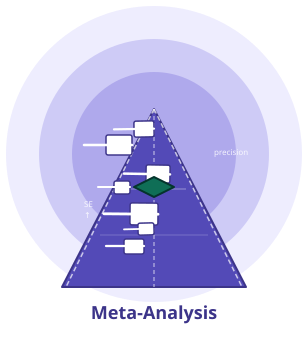
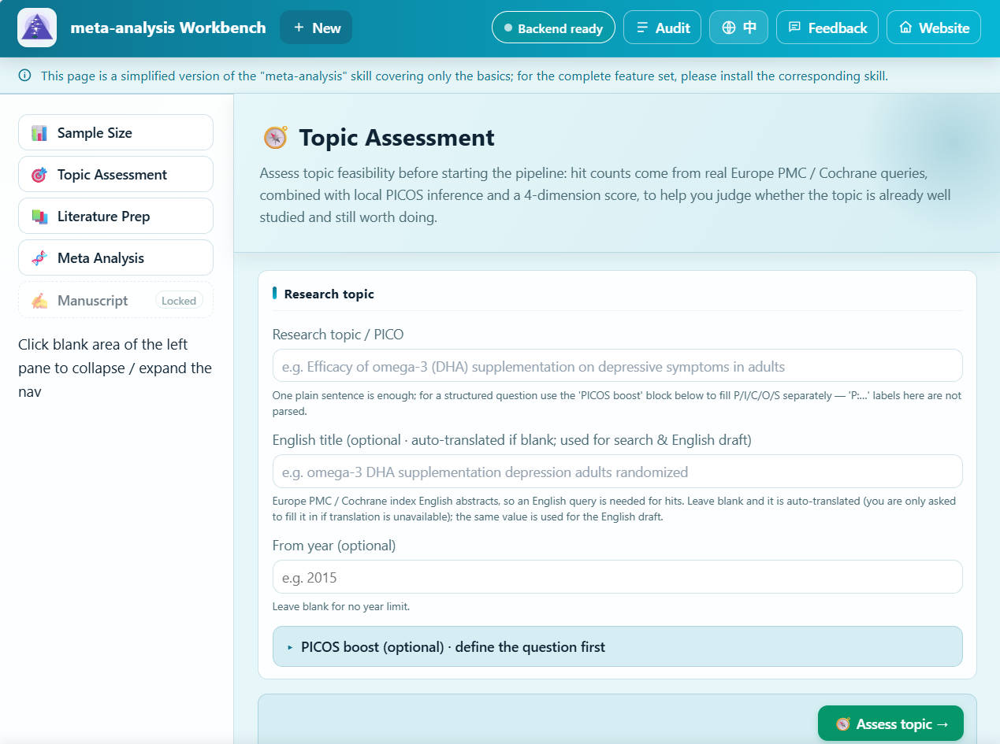

# meta-analysis

- **English guide** → [README.md](https://github.com/medstatstar/meta-analysis/blob/main/README.md) · **中文指南** → [README_zh-CN.md](https://github.com/medstatstar/meta-analysis/blob/main/README_zh-CN.md)

  

> **Works without installation:** If you'd rather not install and just want to quickly use this skill's basic features, you can also visit the web version **https://meta.medstatstar.com** directly.

  

> **Easy-to-use R-based Meta-Analysis for Clinical Researchers**
>
> You don't need to code or memorize commands — just describe your meta-analysis needs in **plain language inside a chat**, and the skill **automatically runs** the full analysis (pooling, figures, report) for you. Powered by R and 14 core + 2 optional professional R packages (metafor, meta, netmeta, bayesmeta, dosresmeta, mada, etc.), it returns results in Chinese or English depending on your OS language setting (you can force-switch via a prompt at any time). Once you describe a request, the skill **auto-executes** and returns results + figures; ask for the full reproducible R code at any time.

---

## Who This Is For

meta-analysis is part of the CT-series skill family, built for three groups:

- **Clinical-trial practitioners at pharmaceutical companies** — sponsors, CROs, and medical / statistical / regulatory roles who need to pool and compare study evidence;
- **Clinicians and nurses who design, conduct, or participate in clinical research** and need meta-analysis / systematic-review support;
- **Medical students who want to learn evidence-based medicine and meta-analysis methodology in a structured way**.

---

## 1. What You Can Do — Scenario Index

The **systematic-review workflow** (upstream gate) comes first; everything else is grouped by **analysis purpose**. Each row gives the typical **clinical scenario** plus a line you can **copy verbatim**. The same analysis may be reached from several entry points.

> The underlying R packages (metafor / meta / netmeta …) are listed in Section 6 "Advanced Reference"; ordinary users don't need to care.

> **📌 Mapping to the five Workbench modules (aligned 2026-10-27)**: this index is co-designed with the published workbench (`https://meta.medstatstar.com`) — **Topic Assessment** (in chat: Case 6 / topic framework), **Literature Prep** (retrieval / screening / PDF download / data extraction — workbench-only, not available in chat), **Meta Analysis** (tables ①–⑤ below, all through the cloud coze R engine), **Sample Size**, **Manuscript** (currently not offered).
>
> **⛔ Manuscript writing is not offered at present**: drafting / AI review / reference verification / pre-submission QA are all unavailable — do not look for them in chat or in the workbench.
>
> **⛔ Entries with no engine support have been removed**: ROBINS-I, RoB traffic-light plot, inconsistency heatmap, AI-assisted screening, graph digitization, missing-value imputation — these have **no corresponding task** in the R engine (calls return `unknown_task`), so never promise or attempt them in chat. For literature retrieval / screening / PDF download use the workbench **Literature Prep** module. RoB 2.0 / RoB 1.0 are provided as **narrative assessments only** (no traffic-light plot).

### ① Systematic Review Workflow

| Scenario | Try saying in chat |
|:---|:---|
| Topic feasibility check | "Judge my topic: efficacy of ×××" (real literature hit counts + 4-dim score verdict) |
| Full topic report | "Produce the full topic-assessment report" (PICO → scoring → dedup → compliance pre-check → 11-section report) |
| Literature retrieval | "Run a systematic search on this topic" (**workbench Literature Prep**: multi-source + dedup + report, delegated to ct-literature) |
| Title/abstract screening (PRISMA) | "Screen the search results" (**workbench**: machine pre-screen + per-record human verdict, PRISMA counts produced automatically) |
| PRISMA flow | "Help me generate a PRISMA flow diagram" |
| PRISMA checklist | "Generate the PRISMA 2020 checklist (27 items)" |
| Data-extraction assistant | "Give me an extraction sheet to fill from the papers" (**in chat**: blank sheet → LLM draft → **line-by-line human verification** → stamp to release; workbench A4 currently not open) |
| Quality gate before pooling | "Run the quality gate" (k count / I² / missing bias check — red cards block) |
| Overclaim check | "Check whether the conclusions overclaim" (abstract claims vs actual evidence) |
| Pre-submission QA | "Run pre-submission evidence QA" (numbers reconciled against statistics, red-line gate) |
| PDF batch download | "Batch download full texts from a DOI list" (**workbench Literature Prep A3**, not available in chat) |

### ② Pairwise Meta-Analysis
| Scenario | Try saying in chat |
|:---|:---|
| Binary (OR/RR/RD) | "Combine the OR across these 5 binary studies" |
| Continuous (SMD/MD) | "Pool the SMD of these 6 continuous studies" |
| Pre-calculated (yi+CI) | "I have effect sizes and CIs for 5 studies — draw the forest plot directly" |
| Survival (HR) | "Pool the HR across these 8 studies" |
| Correlation (r→Zr) | "Convert these 4 correlations via Fisher z then pool" |
| Single-group rate/mean | "Pool the incidence rates across these studies" |
| Generic inverse-variance | "I have yi and vi — run the meta directly" |

### ③ Heterogeneity & Bias
| Scenario | Try saying in chat |
|:---|:---|
| Heterogeneity assessment | "I ran a meta, I² is very high — help me assess heterogeneity" |
| Subgroup analysis | "Run subgroup analysis by region" |
| Meta-regression | "Run meta-regression on publication year and sample size" |
| Egger test | "Check publication bias, run Egger's test" |
| Begg test | "Begg rank-correlation test" |
| Trim-and-fill | "Correct publication bias with trim-and-fill" |
| Selection model | "Assess publication bias with a selection model" |
| Sensitivity analysis | "Run leave-one-out sensitivity analysis" |
| Cumulative meta | "Run cumulative meta by publication year" |
| GOSH plot | "Plot a GOSH graph to see heterogeneity patterns" |
| Baujat diagnosis | "Make a Baujat plot to see which study contributes most heterogeneity" |
| Drapery plot | "Plot a Drapery graph to assess α robustness" |

### ④ Advanced Models
| Scenario | Try saying in chat |
|:---|:---|
| Frequentist NMA | "Run network meta with 4 interventions, use netmeta" |
| Bayesian NMA (Stan) | "Run Bayesian network meta, Stan backend" |
| Bayesian NMA (JAGS) | "Run Bayesian network meta, JAGS backend" |
| Multilevel meta | "Run 3-level meta with multiple effects within studies" |
| Multivariate meta | "Pool a meta with multiple correlated outcomes" |
| IPD meta | "I have individual patient data — run IPD meta" |
| Dose-response | "Run dose-response meta, dosresmeta" |
| Survival meta | "Pool survival HR via metafor (survmeta removed)" |
| Trial sequential analysis | "Run TSA — see how many more studies are needed" |
| Bootstrap meta | "Use Bootstrap for nonparametric DL estimation" |
| Component NMA (CNMA) | "Run component network meta — decompose combination treatments (A+B, additive model) and test the additivity assumption" |
| NMA ranking | "Rank the NMA interventions: SUCRA and P-scores" |
| Diagnostic accuracy meta | "Run diagnostic-accuracy meta — I have tp/fp/fn/tn" |
| Incidence-rate meta | "Run incidence-rate (person-time) meta" |
| Power analysis | "What power does this meta have / how large a sample do I need" |

### ⑤ Effect Size & Conversion
| Scenario | Try saying in chat |
|:---|:---|
| Mean/SD→d | "Convert mean and SD to Cohen's d" |
| t/F→d | "Convert a t value to d" |
| r→Fisher z | "Convert a correlation to Fisher z" |
| d↔logOR | "Convert d to logOR" |
| OR↔logOR | "Convert OR to logOR" |
| Batch convert | "Batch convert SMD to logOR" |
| NNT | "Calculate NNT" |

### ⑥ Visualization
| Scenario | Try saying in chat |
|:---|:---|
| Forest plot | "Draw a forest plot, lancet theme" |
| Funnel plot | "Draw a funnel plot with contour enhancement" |
| Bubble plot | "Draw a meta-regression bubble plot" |
| GOSH plot | "Plot a GOSH graph" |
| Network plot | "Draw the network meta graph" |
| League table | "Draw the NMA league table" |
| Power curve | "Draw a power curve" (→ workbench **Sample Size** module) |
| Drapery plot | "Plot a Drapery graph" |

### ⑦ Study Quality
| Scenario | Try saying in chat |
|:---|:---|
| RoB 2.0 | "Assess risk of bias with RoB 2.0" (narrative assessment, no traffic-light plot) |
| RoB 1.0 | "Assess with Cochrane RoB 1.0" (narrative assessment) |
| GRADE | "Do a GRADE evidence-quality assessment" |
| CINeMA (network evidence) | "Assess the NMA with the CINeMA six domains" |
| PRISMA checklist | "PRISMA checklist" |

### ⑧ Sample Size & Power
| Scenario | Try saying in chat |
|:---|:---|
| Required number of studies (K) | "Roughly how many studies does this meta need for 80% power" (→ workbench **Sample Size** module; leave K blank and it solves in real time) |
| Power back-solve | "Fix 8 studies — what's the power" (fill K to solve for power) |
| Heterogeneity sensitivity | "Assume I² = 50% and compute the required K" / "Scan I² from 0% to 90% and see how K changes" |
| All effect types | "OR = 1.5, 60 patients per study — how many studies do I need" (SMD/OR/RR/r/paired/cluster) |
| Cluster-randomized design | "Cluster-randomized, ICC = 0.05, 30 per cluster — estimate the number of clusters needed" |

---

## 1.1 Supported Figures (23 defined, 22 available in the cloud)

The skill renders **23 analysis figures** on the cloud coze R engine. Pass the plot type via the `plots` field. `prisma_flow` / `prisma` and `rob` / `rob2` resolve to the same figure.

| # | Plot type | 中文名 | English name | Analysis area | Purpose |
|:---:|:---|:---|:---|:---|:---|
| 1 | `forest` | 森林图 | Forest plot | Pairwise / NMA | Pooled effect-size summary |
| 2 | `funnel` | 漏斗图 | Funnel plot | Pairwise | Publication-bias visual |
| 3 | `prisma_flow` | PRISMA 流程图 | PRISMA flow diagram | Systematic review | Four-stage screening flow |
| 4 | `rob` / `rob2` | 偏倚风险图 | RoB traffic-light / summary | Study quality | Cochrane RoB 1.0 / 2.0 (⚠️ currently unavailable: the cloud engine has no plot task — narrative assessment only) |
| 5 | `cumulative` | 累积 Meta 图 | Cumulative meta plot | Pairwise | Accumulated by study order |
| 6 | `baujat` | Baujat 图 | Baujat plot | Heterogeneity | Heterogeneity contributor |
| 7 | `labbe` | L'Abbe 图 | L'Abbe plot | Pairwise (binary) | Effect-consistency check |
| 8 | `radial` | Radial 图 | Radial / Galbraith plot | Heterogeneity | Radial heterogeneity view |
| 9 | `sucra` | SUCRA 排名图 | SUCRA ranking plot | NMA | Intervention rank probability |
| 10 | `egger` | Egger 回归散点图 | Egger's regression plot | Bias | Quantitative bias test |
| 11 | `contribution` | NMA 贡献图 | NMA contribution plot | NMA | Design / comparison contribution |
| 12 | `loo` | 留一法影响图 | Leave-one-out plot | Sensitivity | Sensitivity analysis |
| 13 | `gosh` | GOSH 图 | GOSH plot | Heterogeneity | Heterogeneity pattern clusters |
| 14 | `bubble` | 气泡图 | Bubble plot | Meta-regression | Covariate–effect relationship |
| 15 | `netgraph` | 网络关系图 | Network graph | NMA | Evidence-network structure |
| 16 | `dose_resp` | 剂量反应图 | Dose-response plot | Dose-response | Dose–effect relationship |
| 17 | `drapery` | Drapery 图 | Drapery plot | Sensitivity | α robustness |
| 18 | `sroc` | SROC 曲线 | SROC curve | Diagnostic MA | Diagnostic accuracy |
| 19 | `tsa` | 试验序贯分析图 | Trial sequential analysis | TSA | Evidence sufficiency / required N |
| 20 | `power` | 功效曲线 | Power curve | Power | Statistical power |
| 21 | `influence` | 影响诊断图 | Influence diagnostic plot | Sensitivity | Single-study omission impact |
| 22 | `nodesplit` | 节点拆分图 | Node-splitting plot | NMA | Local inconsistency |
| 23 | `trimfill` | 剪补法漏斗图 | Trim-and-fill funnel plot | Bias | Bias-corrected funnel |

> Note: `netleague` (NMA league table) is a **tabular** output, not a figure, so it is excluded from the count of 23.
> ⚠️ **Figure availability**: item 4 `rob` / `rob2` (RoB traffic-light) has no corresponding task in the cloud engine yet (calls return `unknown_task`) and is **currently unavailable**; RoB 2.0 / RoB 1.0 are provided as narrative assessments only. The remaining 22 figures are available on the cloud coze R engine.

## 2. Case Collection (in a Chat)

meta-analysis is a **conversational skill**: you simply tell the assistant what you want in natural language — no commands, no parameter names to remember. As a WorkBuddy skill it **auto-loads with no extra installation**.

Below are **16 real cases**, graded by difficulty (★ basic / ★★ advanced / ★★★ professional), matching the Scenario Index in §1. Each case has three parts: **"You say"**, **"Assistant replies (sketch)"** and **"🖥️ Workbench"**; illustrative numbers follow real computation conventions (random-effects REML / DL etc.), and actual values depend on your data.

> **Computation runs on the cloud coze R engine by default** (outbound disclosure in Section 5). **Not available in chat**: literature retrieval / screening / PDF download / data extraction (use the workbench **Literature Prep** module) and manuscript writing (currently not offered).

## ★ Basic usage

### Case 1 · Two-group binary meta (the most common)

**You say:**

> Combine the OR across these 5 binary studies:
> Study A: experimental 30/100, control 20/100
> Study B: experimental 45/120, control 30/120
> Study C: experimental 25/90, control 18/85
> Study D: experimental 40/110, control 28/105
> Study E: experimental 35/95, control 22/92

**Assistant replies (sketch):**

> ✅ 5 studies, random-effects model (REML), OR = 1.52 (95%CI: 1.18–1.96), I² = 34%.
> Forest plot generated (summary diamond and I² label included). (Say "give me the full R code" anytime to get reproducible code.)

**🖥️ Workbench:**

> Open the **Meta Analysis** module → upload a CSV (columns `study / ai / bi / ci / di`, or paste the 2×2 tables) → choose "OR" → click **Start flow** (with no data, click "Demo data" to run the whole chain end to end).

### Case 2 · Continuous meta + subgroup (heterogeneity)

**You say:**

> I ran a continuous meta on 8 studies with SMD pooling, but I² is fairly high — I want to subgroup by region.

**Assistant replies (sketch):**

> ✅ 8 studies, SMD = 0.42 (95%CI: 0.15–0.69), I² = 78%.
> Subgroup analysis (region):
>
> - Asia (k=4): SMD = 0.55, I² = 45%
> - Europe/US (k=4): SMD = 0.28, I² = 62%
> - Between-group Q = 4.12, p = 0.04

**🖥️ Workbench:**

> The **Meta Analysis** module currently does **basic pooling only**: upload data (mean / sd / n for both arms) → choose "Continuous / SMD" → click **Run** to get the pooled effect and forest plot. **The module has no subgroup entry** (there is no "subgroup variable" field). For subgroup splits, say "run subgroup analysis by region" in chat — the cloud engine computes along the subgroup dimension; the workbench does not offer that interaction yet.

### Case 3 · Effect-size conversion (d → logOR)

**You say:**

> Convert Cohen's d = 0.8 to logOR.

**Assistant replies (sketch):**

> ✅ d = 0.8 → logOR ≈ 1.45 (SE ≈ 0.38), based on logOR = d × π/√3.

**🖥️ Workbench:**

> The workbench **does not provide** an effect-size converter. Lightweight conversions like this are computed instantly in **chat** — just say "convert d to logOR" (SE included).

### Case 4 · Visualization (forest plot, specified theme)

**You say:**

> Draw a forest plot, lancet theme.

**Assistant replies (sketch):**

> ✅ Forest plot generated (Lancet theme, summary diamond and I² label included). [SVG output, inlined into a single-file HTML report]

**🖥️ Workbench:**

> After any pooling run, the **Meta Analysis** result area **automatically shows a forest plot** (summary diamond + I² label); however it **does not support choosing a theme / style** (lancet / jama / nejm / bmj etc.). For a specific journal theme or an enhanced funnel plot, say "draw a forest plot, lancet theme" in chat.

### Case 5 · Pooling pre-computed effect sizes (yi + CI → forest plot)

**You say:**

> I have 5 studies with ready-made effect sizes and confidence intervals — pool them and draw a forest plot: OR with 95%CI are 1.52[1.18,1.96], 1.31[1.02,1.69], 1.88[1.40,2.53], 1.47[1.13,1.91], 1.66[1.29,2.14].

**Assistant replies (sketch):**

> ✅ 5 studies, random-effects (REML), pooled OR = 1.57 (95%CI: 1.33–1.85), I² = 32%. Forest plot generated (summary diamond and I² label included).
> (Say "give me the full R code" anytime for reproducible code.)

**🖥️ Workbench:**

> The **Meta Analysis** module accepts **pre-computed data**: use columns `study / te / sete` (te = log effect size, sete = standard error), or supply `te / ci_low / ci_high` and the system derives SE → choose the matching effect measure → click **Start flow**; the result area then shows the forest plot. This is the other mainstream input route besides raw 2×2 tables.

## ★★ Advanced usage

### Case 6 · Topic assessment (upstream gate, real dedup probe)

**You say:**

> I'm interested in SGLT2 inhibitors for renal protection in chronic kidney disease (CKD), but I haven't settled on which specific meta direction to pursue. Can you help me sort out candidate directions?

**Assistant replies (sketch):**

> I'll use the **topic-assessment** framework to pin down the direction. First I run the **in-skill dedup probe (real Cochrane + PubMed hit counts)** to check the evidence gap, then propose candidates — a saturated direction is never pushed as the top pick.
>
> **First, cross out the saturated directions**: the generic "SGLT2i on cardiorenal outcomes in CKD" is highly saturated.
> **Candidate ① Meta specific to non-diabetic CKD (top recommendation)**: Cochrane 1 / PubMed (last 5 years) 38 — about 1/11 of the broad direction → a real gap; initial 4-dim score: clinical 5 / feasibility 4 / data 4 / novelty 5.
> **Candidate ② Net-benefit / benefit–risk framework**: Cochrane 5 / PubMed 442 → a gap.
> **Candidate ③ Specific glomerular diseases (FSGS / membranous / ADPKD / lupus)**: FSGS Cochrane 0 → a very deep gap, but RCTs are sparse and power risk is high.
> **Suggestion**: take ① first. Next step: a full topic assessment (PICO breakdown + dedup search + PRISMA / AMSTAR-2 pre-check).

**🖥️ Workbench:**

> Open the **Topic Assessment** module → enter the research topic (Chinese is auto-translated to English and the query is shown) → click **Assess topic**. If the probe fails, the page shows "temporarily unreachable + reason + ↻ retry" instead of silently pretending success.
> ⚠️ The workbench **Topic Assessment** only does a **feasibility quick look** (real hit-count probe + local PICOS scoring); the full assessment (structured PICO, PROSPERO/Cochrane dedup, AMSTAR-2 pre-check, 11-section decision report) requires the skill installed in **chat**.

### Case 7 · Network meta capability routing menu (frequentist vs Bayesian)

**You say:**

> I want to run a network meta with 4 interventions, but I haven't decided between frequentist and Bayesian, and I don't know whether to include dose-response.

**Assistant replies (sketch):**

> 4 interventions is clear. Two key choices remain:
> **① Analysis framework?** (a) Frequentist — `netmeta` (inverse-variance, suits consistent networks, available in the cloud); (b) Bayesian — `gemtc` (JAGS) / `multinma` (Stan), but **JAGS cannot be installed in the cloud container without root**, so use (a) netmeta in the cloud; Bayesian is available locally.
> **② Dose-response?** (a) No (pure pairwise comparison); (b) Yes (needs dose-effect parameters, Bayesian is more suitable).
> **③ Unsure?** → say "explain the differences between these choices in detail" and I'll clarify before you decide.

**🖥️ Workbench:**

> On the **Literature Prep** start page you can tick "Network meta-analysis (NMA)" to launch an NMA (needs 3+ interventions compared in the same network). But **frequentist-vs-Bayesian framework choice, dose-response and other advanced options are not offered in the workbench** — decide in chat (frequentist `netmeta` works in the cloud; Bayesian `gemtc` / `multinma` depend on JAGS, usually unavailable in the container without root, available locally).

### Case 8 · Publication-bias diagnosis (Egger + trim-and-fill)

**You say:**

> I ran a meta; I² isn't high, but I'm worried about publication bias — run Egger's test and correct with trim-and-fill.

**Assistant replies (sketch):**

> ✅ Egger regression intercept = 1.83 (SE 0.61), p = 0.006 → signs of small-study bias.
> Trim-and-fill estimate: after imputing 3 "missing" studies, the adjusted OR = 1.31 (from 1.52) — the direction is unchanged but the effect size shrinks.

**🖥️ Workbench:**

> After pooling, the result area **only produces basic figures such as the forest plot**; it **does not provide** Egger / Begg / trim-and-fill entries. Say "run Egger's test and correct with trim-and-fill" in chat to compute on the cloud engine.

### Case 9 · Meta-regression (continuous covariate)

**You say:**

> Use age as a continuous covariate in a meta-regression and see whether it explains part of the heterogeneity.

**Assistant replies (sketch):**

> ✅ Meta-regression (age continuous): slope β = 0.012/year (95%CI 0.003–0.021), p = 0.009; age explains part of the heterogeneity (R² ≈ 0.41).

**🖥️ Workbench:**

> The **Meta Analysis** module **does not provide** a meta-regression (metareg) entry (no "covariate" field). Say "use age as a continuous covariate in a meta-regression" in chat to compute on the cloud engine; the bubble plot comes back with the result.

### Case 10 · Full systematic-review workflow (workbench Literature Prep: search → screen → PDF → extract)

**You say:**

> I want to go all the way from search to meta: systematic search, screening, download PDFs, extract data.

**Assistant replies (sketch):**

> This end-to-end flow is best run in the **workbench Literature Prep** module (search / screening / PDF download happen in the workbench; data extraction is not open in the workbench yet and is provided in chat). The flow is: A1 topic contract → A2 cross-database search (OpenAlex + Europe PMC, Cochrane optional) → A3 full-text PDF download → A4 data extraction (LLM draft + **line-by-line human verification gate**). Every stage stops automatically at its human gate and never skips silently. Shall I walk you through the workbench?

**🖥️ Workbench:**

> Open the **Literature Prep** module → enter the topic → choose data sources (Cochrane is linked with "include reviews") → click **Start flow**; A2 search → A3 PDF download → screening verdicts (export an xlsx verdict sheet with DOI + document-type confirmation columns).
> ⚠️ **A4 data extraction is currently not open**: the workbench does not extract 2×2 data from PDFs automatically; extract in chat or supply your own verified CSV. The "nothing enters pooling unverified" red line applies in chat / local flows.

### Case 11 · Trial sequential analysis (TSA — how many more studies for a robust conclusion)

**You say:**

> This meta only has 4 studies so far — I want a trial sequential analysis (TSA) to see how stable the conclusion is and how many more studies are needed.

**Assistant replies (sketch):**

> ✅ TSA (alpha-spending 0.05, power 80%, expected effect based on the current pooled HR = 0.82): current information ≈ 38% of required; the boundary has not been crossed, so about 7 more comparable studies (total k ≈ 11) are needed before a "robust conclusion" can be drawn. Current evidence **suggests a direction but is not yet sufficient**.

**🖥️ Workbench:**

> TSA is an advanced model and the **Meta Analysis** module **does not provide** a TSA entry. Say "run TSA and see how many more studies are needed" in chat to compute on the cloud engine (the `meta` package TSA flow); the result includes the information curve and the required number of studies.

### Case 12 · Study-quality assessment (RoB 2.0 + GRADE, narrative)

**You say:**

> Assess risk of bias for this batch of RCTs and give me a GRADE evidence-quality rating.

**Assistant replies (sketch):**

> ✅ **RoB 2.0** (5 domains: randomization, deviations from intended interventions, missing data, outcome measurement, selective reporting): 3 low risk, 2 some concerns. This is a **narrative assessment** (per-domain judgments and overall risk in chat, no traffic-light visualization).
> ✅ **GRADE**: starts high for randomized trials; downgraded for inconsistency (I² = 55%) and imprecision (k = 5, wide CI) → final **moderate** certainty.

**🖥️ Workbench:**

> RoB 2.0 / RoB 1.0 / GRADE assessments are **not available** in the workbench (the manuscript module is closed overall). Say "assess risk of bias with RoB 2.0 and run GRADE" in chat — note this is a **narrative assessment** without ROBINS-I or the traffic-light plot (neither has a corresponding engine task; both were removed).

## ★★★ Professional usage

### Case 13 · Survival meta (pooled HR)

**You say:**

> Pool the HR across 8 studies (survival data; each study gives logHR and SE).

**Assistant replies (sketch):**

> ✅ 8 studies, random-effects (REML), pooled HR = 0.82 (95%CI: 0.71–0.95), I² = 41%. Forest plot generated (HR scale).

**🖥️ Workbench:**

> In the **Meta Analysis** module choose "HR" → upload data containing `hr / ci_low / ci_high` (or pre-computed `te / sete`) → click **Start flow**; demo data works too. The result area then shows the forest plot on the HR scale.

### Case 14 · Single-group rate / diagnostic-accuracy meta

**You say:**

> Pool the incidence rates across these studies (single-group rate); separately, I have a batch of diagnostic studies with tp / fp / fn / tn — run a diagnostic-accuracy meta.

**Assistant replies (sketch):**

> ✅ Single-group rate meta: pooled incidence = 0.23 (95%CI: 0.17–0.30), I² = 55%.
> ✅ Diagnostic-accuracy meta: pooled sensitivity = 0.86 (95%CI: 0.80–0.91), specificity = 0.79 (95%CI: 0.72–0.85); SROC curve AUC = 0.89.

**🖥️ Workbench:**

> The workbench **Meta Analysis** module **supports only OR / RR / SMD / MD / HR pooling** and has **no** "single-group rate" or "diagnostic accuracy" entry (the effect-measure dropdown has no proportion / diagnostic option). Run single-group-rate and diagnostic-accuracy metas (tp / fp / fn / tn) in **chat**; the SROC curve comes back with the result.

### Case 15 · Sample-size estimation (workbench "Sample Size" module)

**You say:**

> I'm planning a meta on "SGLT2 for renal protection in CKD", expecting SMD ≈ 0.5, about 50 patients per study, I² = 50% — roughly how many studies do I need for 80% power?

**Assistant replies (sketch):**

> Sample-size estimation runs in the **workbench "Sample Size" module** (not open in chat yet). In the web UI pick the effect type (SMD / OR / RR / r / paired / cluster) and fill in the parameters to solve in real time: leave K blank to solve for the required number of studies, fill K to solve for power. Example (SMD = 0.5, N = 50, I² = 50%, α = 0.05 two-sided, target power 80%) → required studies K ≈ 3; fixing K = 8 → power ≈ 0.99.

**🖥️ Workbench:**

> Open the **Sample Size** module → pick the effect type → fill in SMD / N per study / I² / α / target power → compute; inputs and results persist when switching tabs.

### Case 16 · Cross-turn continuity (echo-block inheritance, no silent mismapping)

**You say:**

> (Turn 1) Pool these 5 ORs. (Turn 2) Subgroup by age. (Turn 3) Drop the largest study for a sensitivity analysis.

**Assistant replies (sketch):**

> After each analysis I echo a `## Current analysis settings` block (data / measure / model / method / yi / sei / slab / subgroup / task). Follow-up questions change only the fields that differ; the column mapping (yi / sei / slab) is inherited as-is — avoiding the silent failure where "it computed but the columns were mismapped".
>
> - Turn 2: the subgroup (age) automatically reuses Turn 1's column mapping.
> - Turn 3: the sensitivity analysis re-runs as `task = pairwise_meta` with the largest study dropped (the cloud has no standalone sensitivity task); the subgroup framework is retained.

**🖥️ Workbench:**

> The cross-turn "Current analysis settings" echo block and column-mapping inheritance are **chat-only** capabilities; each pooling run in the workbench **starts independently**, with no echo block and no automatic inheritance of the previous column mapping (yi / sei / slab). Re-upload / re-paste the data for repeated analyses to avoid mismapped columns.

---

## 3. First-Time FAQ

**Q: I only gave effect size and study count, no other parameters — will it still compute?**
A: Yes. Pooling analyses only need the **per-study effect data** (binary `ai/bi/ci/di`, continuous `mean/sd/n`, or pre-computed `te/seTE`); unspecified options are filled with sensible defaults (random-effects REML/DL, two-sided α = 0.05, 1:1 allocation, etc.). If a **required** parameter is missing (e.g. mean or sd for two-arm continuous data), the assistant asks first and then computes.

**Q: Is the n in the result per group or total?**
A: By default it's **per group**; paired / crossover designs report per-sequence, and survival often reports total events needed. The output always labels this clearly.

**Q: Does the analysis run as soon as I describe a request?**
A: Yes. Once you describe the request, the assistant **auto-executes** and returns the real numbers + figures — no extra trigger word needed. Computation runs on the cloud coze R engine (data disclosure in Section 5).

**Q: I want the reproducible R code for submission or audit — how do I ask?**
A: Say **"give me the full R code"**. Every analysis returns reproducible R code (with R and package versions), which you can copy, modify, and re-run yourself.

**Q: On a Chinese system, is the output in Chinese?**
A: Yes. By default the output language follows your OS language setting — Chinese on a Chinese-OS, English otherwise. This default requires no extra permission and only affects display language; you can force-switch anytime via a prompt (e.g. "用中文回复" / "switch to English").

**Q: My data is in SPSS/Excel/Stata format — what do I do?**
A: Say **"help me convert my SPSS/Excel data to CSV"** — the assistant will recommend installing `@skill:statdata-transfer` for 50+ format conversions.

**Q: What if my data must stay confidential?**
A: Run the whole analysis with **simulated / placeholder data**, then ask the skill for the **full reproducible R code** and run it yourself locally with your real data. The skill itself only sends your **analysis parameters / summary statistics** (event counts, sample sizes, effect sizes) to the cloud coze R engine — it **never touches your raw datasets or individual-patient records** (unless you explicitly choose to run an IPD analysis through the cloud, in which case sending IPD to the cloud is your decision).

**Q: What if I found an error in the result — how do I report it?**
A: This skill follows the standard bug-report workflow. If you suspect the result is wrong (or the engine errored), just say **"report a bug" / "上报问题" / "提交错误报告"**. The skill also **proactively asks** whether to report when it detects a likely defect (e.g. the engine errors or retries still fail) — at most **once per session**, and you can always decline. Either way, the assistant will:
1. **Propose a sanitized report** (11-field whitelist: skill / skill_version / test / error_type / error_code / engine_status / description / locale / query_origin / session_hash / attempts — **no raw input values or personal data**, except the `description` field where you decide what to disclose, e.g. the algorithm/function used and the error message);
2. **Show the full report text for your review** — you can add a problem description or correct anything before confirming;
3. **Send after your explicit confirmation** — to the unified endpoint `https://ct-bugreport.coze.site/run` (if this session called coze) or, if purely local, **save the sanitized report locally and show you the author contact** so you can email it yourself if you choose (the skill itself does not send it; data never leaves your machine unless you email it);
4. **Receive an acknowledgment** — including whether a previously submitted report from your source has already been fixed (with the fix note) or is still pending.

You stay in full control: the report is shown to you **before** anything is sent, and nothing is transmitted without your explicit "send" confirmation.

**Q: I see an error in the workbench (web UI) — what do I do?**
A: In the workbench, the result area states the specific cause and offers a **Retry** entry — follow the prompt to retry or adjust the input. If you suspect the **analysis result is wrong** or it is an engine-logic issue, say "report a bug" in chat (see the previous item) — bug reporting is a chat-only capability; the workbench has no reporting entry.

---

## 4. Execution Model

- **Auto-execution:** Once you describe a request, the skill **auto-executes** the analysis and returns real numbers + figures — no extra trigger word or confirmation needed. Computation runs on the cloud coze R engine by default.
- **Default compute path:** The skill sends the analysis request to the cloud coze R engine (`https://ct-meta.coze.site/run`) (data disclosure in Section 5).
- **Reproducible code:** Every analysis returns reproducible R code (with R + package versions); say **"give me the full R code"** to obtain it for submission or audit.
- **Outbound authorization:** The default endpoint is pre-approved and runs automatically; a custom endpoint (`COZE_META_ENDPOINT`) asks for confirmation on first use (see Section 5).
- **Output is for reference only** — validate before journal submission or regulatory use.

---

## 5. Data & Privacy

The skill sends data externally in **two** situations: ① when you describe an analysis request, the skill **auto-sends** the analysis request to execute; ② when you confirm sending an error report. **Neither sends personal identifiers.**

**5.1 Analysis request (cloud computation)**
- **What is sent:** your **analysis data** — **summary statistics** such as study event counts / sample sizes / effect sizes. No personal identifiers; payloads are sanitized before sending.
- **When:** the skill **auto-sends** after you describe a request; **before the first outbound call each session**, the skill gives you a one-time spoken disclosure of what is sent and to which endpoint (then executes automatically, without per-call confirmation).
- **Endpoint:** default `https://ct-meta.coze.site/run` (pre-approved in `adapters/config.json` `auto_approve_endpoints`). A custom endpoint (`COZE_META_ENDPOINT`) asks for confirmation on first use (AUTH-BLOCK), and is persisted to the whitelist after you approve.
- **If declined:** the skill returns a clear "cloud analysis not used" message.

**5.2 Metadata sent with the request**
Each request also carries two metadata fields (**in both the analysis request and the error report**):
- `query_origin`: a SHA-256 hash of your machine hostname, used only for server-side attribution / rate-limiting — **not** your plaintext hostname;
- `locale`: your OS language, for bilingual output.

Neither is used to identify you personally.

**5.3 Error report**
- **What is sent:** **only** the 11-key whitelist envelope (skill / skill_version / test / error_type / error_code / engine_status / description / locale / query_origin / session_hash / attempts) — **no analysis data and no personal identifiers**. `description` is the only free-text field, and you review it before consent (hard boundary: no identifiable person/institution/subject info).
- **Endpoint:** unified bug-report endpoint `https://ct-bugreport.coze.site/run`.
- **If declined:** nothing is sent; if there is no cloud call this session, the report is saved locally instead (`save_local_report`, data never leaves the machine).

> **In one sentence:** your **analysis summary data** is **auto-sent** to the cloud after you describe a request (with a one-time disclosure before the first outbound call each session); **error reports** go to the unified endpoint only after your confirmation; the two metadata fields (`query_origin` hash + `locale`) are for anonymous attribution. Raw data and individual records never leave your machine.

---

## 6. Advanced Reference (moved to a separate file)

CLI examples, bidirectional solving, curve mode, core formulas, system requirements, common errors, full file structure, and references for developers have been moved to **[references/ADVANCED.md](references/ADVANCED.md)**. Ordinary users don't need it; see Sections 1-5 for daily use.

---

**Version**: v2.21.1 | **License**: MIT | **Authors**: medstatstar, phoe-zip

For feature requests, bug reports, or other feedback, please contact the author directly at medstatstar@gmail.com (Wintone Zhang / 张文彤).

---

## Confidentiality Notice

> The CT series consists of 20+ specialized domain skills, organized into **two tiers — A, B** — by "whether the input contains confidential information" (network / egress / publish are independent orthogonal attributes; see ct-base §11), providing full coverage of the entire new-drug clinical trial (Clinical Trial) lifecycle.
>
> - **Tier A (non-confidential input)**: run fully locally using only ordinary data; Tier A may need external public retrieval but involves no confidential information. These skills are published openly on GitHub.
> - **Tier B (confidential input)**: accept strictly confidential clinical-trial data / protocols / CRFs from pharma sponsors (e.g., ct-analysis, ct-sdtm, ct-protocol, ct-eligibility); Tier B is processed locally and never leaves the boundary (egress=none), or additionally requires policy approval (egress=approval-req, e.g. ct-eligibility). Tier B packages contain zero confidential data but are NOT publicly published (stays fully local) — confidential input never ships with the package or leaves the machine. For custom / on-prem deployment, contact the author.
>
> 📧 Contact: medstatstar@gmail.com (Wintone Zhang / 张文彤)
