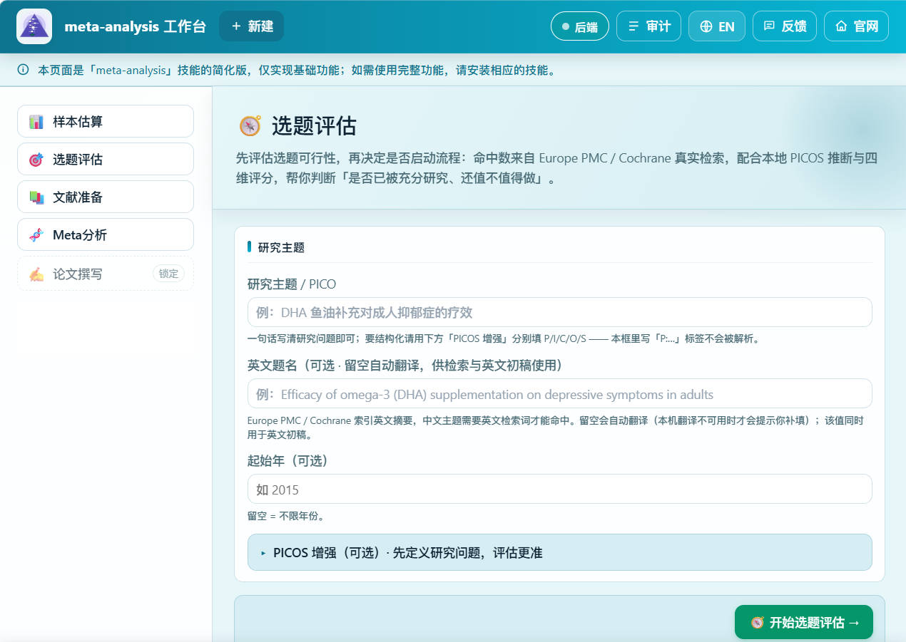

# meta-analysis 技能

- **English guide** → [README.md](https://github.com/medstatstar/meta-analysis/blob/main/README.md) · **中文指南** → [README\_zh-CN.md](https://github.com/medstatstar/meta-analysis/blob/main/README_zh-CN.md)

    
      

> **不安装也能用：** 如果你不想安装，只想快速使用本技能的基础功能，也可直接访问网页版 **[https://meta.medstatstar.com](https://meta.medstatstar.com)** 使用。

  

> **临床研究者友好的 R 语言 Meta 分析技能**
>
> 无需编程、无需记忆命令——在对话中用**自然语言**描述你的 Meta 分析需求，技能**自动完成**全套分析（合并计算、出图、报告）。底层基于 R 与 14 核心 + 2 可选专业 R 包（metafor、meta、netmeta、bayesmeta、dosresmeta、mada 等），输出语言随操作系统语言自动切换（中文系统出中文，否则出英文；可随时强制切换）。你提出需求后，技能**自动执行**分析并返回结果与图形；如需复现代码，可随时索要完整可复现 R 代码。

---

## 适用人群

meta-analysis 属于 `ct-*` 临床试验技能家族，主要面向三类人群：

- **各制药企业的临床试验从业者** —— 申办方、CRO，以及医学 / 统计 / 注册等角色，需要合并与比较研究证据；
- **在医疗机构中设计、开展或参与临床研究的医生与护士**，需要 Meta 分析 / 系统评价支持；
- **希望系统学习循证医学与 Meta 分析方法学的医学专业学生**。

---

## 1. 能做什么——场景索引

**系统评价流程**（上游门控）排最前，其余按**分析目的**分组。每行给典型临床场景 + 可直接抄写的自然语言。同一分析可能从多个入口到达。

> 底层 R 包名（metafor / meta / netmeta …）见第 6 节「进阶参考」；普通用户无需关心。

> **📌 与工作台五大模块对应（2026-10-27 对齐）**：本索引分类与已发布工作台（`https://meta.medstatstar.com`）同源——**选题评估**（对话态走案例 6 / 选题框架）、**文献准备**（检索 / 初筛 / PDF 下载 / 数据提取，工作台专属，对话态不提供）、**Meta 分析**（下表 ①–⑤ 全部走云端 coze R 引擎）、**样本估算**、**论文撰写**（当前不提供）。
>
> **⛔ 论文撰写当前不提供**：初稿撰写 / AI 评审 / 参考核验 / 投稿前 QA 均不可用，请勿在对话或工作台中寻求该功能。
>
> **⛔ 无引擎支持的条目已移除**：ROBINS-I、RoB 交通灯图（plot）、不一致性热图、AI 辅助文献筛选、图形数字化、缺失值插补——这些在 R 引擎中**不存在对应 task**（调用会返回 `unknown_task`），对话态不得承诺或尝试调用。文献检索 / 筛选 / PDF 下载请使用工作台「文献准备」模块。RoB 2.0 / RoB 1.0 仅作叙述性评估（不含交通灯图）。

### ① 系统评价流程

| 场景           | 试试这样说                                                          |
| :----------- | :------------------------------------------------------------- |
| 选题可行性速览      | "帮我判断选题：××× 的疗效"（真实文献命中数 + 4 维评分裁决）                            |
| 选题完整报告       | "给这个选题出完整的选题评估报告"（PICO → 评分 → 查重 → 合规预检 → 11 节报告）              |
| 文献检索与整理      | "围绕这个主题做系统检索"（**工作台「文献准备」模块**：跨库检索 + 去重 + 报告，委托 ct-literature） |
| 文献初筛（PRISMA） | "对检索结果做标题摘要初筛"（**工作台**：机器预筛 + 人工逐条裁决，自动出 PRISMA 计数）            |
| PRISMA 流程图   | "帮我生成 PRISMA 流程图"                                              |
| PRISMA 检查表   | "生成 PRISMA 2020 检查表（27 项）"                                     |
| 数据提取助手       | "生成数据提取表，我从文献里填"（**对话态**：空白表 → LLM 草稿 → **人工逐行核验** → 盖章放行；工作台 A4 当前未开放）  |
| 合并前质量门       | "过一遍质量门"（k 数 / I² / 偏倚检查缺项红牌拦截）                                |
| 过度声明检测       | "检查结论有没有过度声明"（摘要宣称 vs 实际证据比对）                                  |
| 投稿前 QA       | "投稿前做一遍证据链 QA"（数字与统计结果对账，红线闸）                                  |
| PDF 批量下载     | "从 DOI 列表批量下载全文"（**工作台「文献准备」A3 模块**，对话态不提供）                    |

### ② 成对（两臂）Meta 分析

| 场景             | 试试这样说                        |
| :------------- | :--------------------------- |
| 二分类 (OR/RR/RD) | "合并这 5 项二分类研究的 OR"           |
| 连续型 (SMD/MD)   | "合并 6 项连续型研究的 SMD"           |
| 预计算 (yi+CI)    | "我有 5 个研究的效应量和 CI，直接画森林图"    |
| 生存 (HR)        | "合并 8 项研究的 HR"               |
| 相关 (r→Zr)      | "把这 4 个相关系数做 Fisher z 转换后合并" |
| 单组率/均值         | "合并这几个研究的发病率"                |
| 通用逆方差          | "我有 yi 和 vi，直接做 Meta"        |

### ③ 异质性与发表偏倚

| 场景        | 试试这样说                      |
| :-------- | :------------------------- |
| 异质性评估     | "我做了 Meta，I² 很高，帮我看下异质性"   |
| 亚组分析      | "按地区做亚组分析"                 |
| 元回归       | "做元回归，看发表年份和样本量的影响"        |
| Egger 检验  | "检查发表偏倚，做 Egger 检验"        |
| Begg 检验   | "Begg 秩相关检验"               |
| 剪补法       | "用剪补法校正发表偏倚"               |
| 选择模型      | "用 selection model 评估发表偏倚" |
| 敏感性分析     | "做 leave-one-out 敏感性分析"    |
| 累积 Meta   | "按发表年份做累积 Meta"            |
| GOSH 图    | "画 GOSH 图看异质性模式"           |
| Baujat 诊断 | "做 Baujat 图，看哪个研究贡献最大异质性"  |
| Drapery 图 | "画 Drapery 图评估 α 稳健性"      |

### ④ 高级模型

| 场景 | 试试这样说 |
| :--- | :--- |
| 频率学派 NMA | "做网络 Meta，4 种干预，用 netmeta" |
| 贝叶斯 NMA (Stan) | "做贝叶斯网络 Meta，Stan 后端"（本地可用；云端 JAGS 不可用） |
| 贝叶斯 NMA (JAGS) | "做贝叶斯网络 Meta，JAGS 后端"（仅本地） |
| 多水平 Meta | "做 3 水平 Meta，研究内多个效应" |
| 多变量 Meta | "合并多个相关结局的 Meta" |
| IPD Meta | "我有患者个体数据，做 IPD Meta" |
| 剂量反应 | "做剂量反应 Meta，dosresmeta" |
| 生存 Meta | "用 metafor 合并生存 HR（survmeta 已移除）" |
| 试验序贯分析 | "做 TSA，看还需要多少研究" |
| Bootstrap Meta | "用 Bootstrap 做非参数 DL 估计" |
| 成分网络 Meta (CNMA) | "做成分网络 Meta，把复方按组分分解（A+B 加法模型），并检验相加性假设" |
| NMA 排序 | "给网络 Meta 出排序：SUCRA 和 P-score" |
| 诊断准确性 Meta | "做诊断准确性 Meta，我有 tp/fp/fn/tn" |
| 发病率 Meta | "做发病率（incidence rate）Meta，有人时数据" |
| 统计功效 | "算一下这个 Meta 的功效 / 需要多少样本"（→ 工作台「样本估算」模块） |

### ⑤ 效应量与转换

| 场景 | 试试这样说 |
| :--- | :--- |
| 均值/SD→d | "把均值标准差转成 Cohen's d" |
| t/F→d | "把 t 值转成 d" |
| r→Fisher z | "把相关系数转成 Fisher z" |
| d↔logOR | "把 d 转成 logOR" |
| OR↔logOR | "把 OR 转成 logOR" |
| 批量转换 | "批量把 SMD 转成 logOR" |
| NNT | "计算 NNT" |

### ⑥ 可视化

| 场景 | 试试这样说 |
| :--- | :--- |
| 森林图 | "画森林图，lancet 主题" |
| 漏斗图 | "画漏斗图，带轮廓增强" |
| 气泡图 | "画元回归气泡图" |
| GOSH 图 | "画 GOSH 图" |
| 网络图 | "画网络 Meta 的网络图" |
| 联赛表 | "画 NMA 联赛表" |
| 功效曲线 | "画功效曲线"（→ 工作台「样本估算」模块） |
| Drapery 图 | "画 Drapery 图" |

### ⑦ 研究质量

| 场景 | 试试这样说 |
| :--- | :--- |
| RoB 2.0 | "用 RoB 2.0 评估偏倚风险"（叙述性评估，不含交通灯图） |
| RoB 1.0 | "用 Cochrane RoB 1.0 评估"（叙述性评估） |
| GRADE | "做 GRADE 证据质量评价" |
| CINeMA（网络证据质量） | "用 CINeMA 六域评估网络 Meta 的质量" |
| PRISMA 检查表 | "PRISMA 检查表" |

### ⑧ 样本量与效能规划

| 场景 | 试试这样说 |
| :--- | :--- |
| 所需研究数（K） | "这个 Meta 大概需要几项研究才有 80% 效能"（→ 工作台「样本估算」模块，留空 K 实时求解） |
| 效能反推 | "固定 8 项研究，效能是多少"（填 K 求效能） |
| 异质性敏感性 | "I² 按 50% 估，帮我算所需 K" / "把 I² 从 0% 扫到 90%，看所需 K 怎么变" |
| 各类效应量 | "OR=1.5、每研究 60 例，需要几项研究"（SMD/OR/RR/r/配对/整群） |
| 整群随机设计 | "整群随机、ICC=0.05、每群 30 例，估算需要多少群" |

---

## 1.1 支持的分析图形（23 种定义，22 种云端可用）

技能在云端 coze R 引擎上可渲染分析图形。图形类型通过 `plots` 字段传入。`prisma_flow`/`prisma` 与 `rob`/`rob2` 指向同一图形。

|  #  | 图形类型 | 中文名 | English name | 所属分析 | 用途 |
| :-: | :--- | :--- | :--- | :--- | :--- |
|  1  | `forest` | 森林图 | Forest plot | 两组 / NMA | 效应量合并主图 |
|  2  | `funnel` | 漏斗图 | Funnel plot | 两组 | 发表偏倚可视化 |
|  3  | `prisma_flow` | PRISMA 流程图 | PRISMA flow diagram | 系统评价 | 文献筛选四阶段流程 |
|  4  | `rob` / `rob2` | 偏倚风险图 | RoB traffic-light / summary | 研究质量 | Cochrane RoB 1.0 / 2.0（⚠️ 暂不可用：云端引擎未实现 plot，仅叙述性评估） |
|  5  | `cumulative` | 累积 Meta 图 | Cumulative meta plot | 两组 | 按研究序累积合并 |
|  6  | `baujat` | Baujat 图 | Baujat plot | 异质性 | 异质性来源诊断 |
|  7  | `labbe` | L'Abbe 图 | L'Abbe plot | 两组（二分类） | 效应一致性检查 |
|  8  | `radial` | Radial 图 | Radial / Galbraith plot | 异质性 | 异质性径向展示 |
|  9  | `sucra` | SUCRA 排名图 | SUCRA ranking plot | NMA | 干预排序概率 |
|  10 | `egger` | Egger 回归散点图 | Egger's regression plot | 偏倚 | 发表偏倚定量 |
|  11 | `contribution` | NMA 贡献图 | NMA contribution plot | NMA | 设计/比较对贡献分解 |
|  12 | `loo` | 留一法影响图 | Leave-one-out plot | 敏感性 | 敏感性分析 |
|  13 | `gosh` | GOSH 图 | GOSH plot | 异质性 | 异质性模式聚类 |
|  14 | `bubble` | 气泡图 | Bubble plot | Meta 回归 | 协变量-效应量关系 |
|  15 | `netgraph` | 网络关系图 | Network graph | NMA | 证据网络结构 |
|  16 | `dose_resp` | 剂量反应图 | Dose-response plot | 剂量反应 | 剂量-效应关系 |
|  17 | `drapery` | Drapery 图 | Drapery plot | 敏感性 | α 稳健性 |
|  18 | `sroc` | SROC 曲线 | SROC curve | 诊断 Meta | 诊断准确性 |
|  19 | `tsa` | 试验序贯分析图 | Trial sequential analysis | TSA | 证据充分性/所需样本 |
|  20 | `power` | 功效曲线 | Power curve | 功效 | 统计检验效能 |
|  21 | `influence` | 影响诊断图 | Influence diagnostic plot | 敏感性 | 单研究剔除影响 |
|  22 | `nodesplit` | 节点拆分图 | Node-splitting plot | NMA | 局部不一致性 |
|  23 | `trimfill` | 剪补法漏斗图 | Trim-and-fill funnel plot | 偏倚 | 偏倚校正漏斗 |

> 说明：`netleague`（NMA 联赛表）为表格型输出而非图形，故不计入 23 种。
> ⚠️ **图形可用性**：第 4 项 `rob`/`rob2`（RoB 交通灯图）当前云端引擎未实现对应 task（调用返回 `unknown_task`），**暂不可用**；RoB 2.0 / RoB 1.0 仅提供叙述性评估。其余 22 种图形在云端 coze R 引擎可用。

## 2. 使用案例大全（对话中使用 · 核心）

meta-analysis 是**对话式技能**：用自然语言告诉助手你要做什么——无需命令、无需记忆参数名。作为 WorkBuddy 技能，**自动加载、无需额外安装**。

下面按**难度分级**（★ 基础 / ★★ 进阶 / ★★★ 专业）给出 16 个真实案例，与 §1 场景索引对应。每个案例含 **「你这样说」**、**「助手会这样回（示意）」** 和 **「🖥️ 网页工作台」** 三段；示意数字为真实计算口径示例（随机效应 REML / DL 等），实际值随你的数据而定。

> **计算默认走云端 coze R 引擎**（出站披露见第 5 节）。**对话态不提供**文献检索 / 初筛 / PDF 下载 / 数据提取（请用工作台「文献准备」模块）与论文撰写（当前不提供）。

## ★ 基础用法

### 案例 1 · 两组二分类 Meta（最常见）

**你这样说：**

> 合并以下 5 项二分类研究的 OR：  
> 研究A: 实验组 30/100, 对照组 20/100  
> 研究B: 实验组 45/120, 对照组 30/120  
> 研究C: 实验组 25/90, 对照组 18/85  
> 研究D: 实验组 40/110, 对照组 28/105  
> 研究E: 实验组 35/95, 对照组 22/92

**助手会这样回（示意）：**

> ✅ 5 项研究，随机效应模型（REML），OR = 1.52（95%CI: 1.18–1.96），I² = 34%。  
> 已生成森林图（含汇总菱形与 I² 标注）。（可随时说「给我完整 R 代码」取可复现代码。）

**🖥️ 工作台：**

> 进入「Meta 分析」模块 → 上传 CSV（列名 `study / ai / bi / ci / di`，或粘贴四格表）→ 效应量选「OR」→ 点「启动流程」（无数据可点「演示数据」跑通整条链路）。

### 案例 2 · 连续型 Meta + 亚组（异质性）

**你这样说：**

> 我做了 8 项研究的连续型 Meta，SMD 合并，但 I² 比较高，想按地区做亚组。

**助手会这样回（示意）：**

> ✅ 8 项研究，SMD = 0.42（95%CI: 0.15–0.69），I² = 78%。  
> 亚组分析（地区）：
>
> - 亚洲（k=4）：SMD = 0.55，I² = 45%
> - 欧美（k=4）：SMD = 0.28，I² = 62%
> - 组间 Q = 4.12，p = 0.04

**🖥️ 工作台：**

> 「Meta 分析」模块当前只做**基础合并**：上传数据（mean / sd / n 两组）→ 选「连续型 / SMD」→ 点「运行」，输出合并效应与森林图。**该模块不含亚组分析入口**（没有「亚组变量」填列框）。要做亚组拆分，请在对话态直接说「按地区做亚组分析」——由云端引擎按 subgroup 维度计算，工作台暂不提供该交互。

### 案例 3 · 效应量转换（d → logOR）

**你这样说：**

> 把 Cohen's d = 0.8 转成 logOR。

**助手会这样回（示意）：**

> ✅ d = 0.8 → logOR ≈ 1.45（SE ≈ 0.38），基于公式 logOR = d × π/√3。

**🖥️ 工作台：**

> 工作台**暂不提供**效应量换算工具。这类轻量换算直接在**对话态**说「把 d 转成 logOR」即可实时得出（含 SE）。

### 案例 4 · 可视化（森林图，指定主题）

**你这样说：**

> 画森林图，lancet 主题。

**助手会这样回（示意）：**

> ✅ 森林图已生成（Lancet 主题，含汇总菱形与 I² 标注）。[SVG 输出，内联于单文件 HTML 报告]

**🖥️ 工作台：**

> 任意合并分析后，「Meta 分析」结果区会**自动给出森林图**（含汇总菱形与 I² 标注）；但**不支持指定主题 / 风格**（lancet / jama / nejm / bmj 等）。需要特定期刊主题或漏斗图增强，请在对话态说「画森林图，lancet 主题」。

### 案例 5 · 预计算效应量直接合并（yi + CI → 森林图）

**你这样说：**

> 我有 5 个研究现成的效应量和置信区间，直接合并画森林图：OR 与 95%CI 分别是 1.52[1.18,1.96]、1.31[1.02,1.69]、1.88[1.40,2.53]、1.47[1.13,1.91]、1.66[1.29,2.14]。

**助手会这样回（示意）：**

> ✅ 5 项研究，随机效应（REML），合并 OR = 1.57（95%CI: 1.33–1.85），I² = 32%。已生成森林图（含汇总菱形与 I² 标注）。  
> （可随时说「给我完整 R 代码」取可复现代码。）

**🖥️ 工作台：**

> 「Meta 分析」模块支持**预计算数据**上传：列名用 `study / te / sete`（te=效应量对数、sete=标准误），或给 `te / ci_low / ci_high` 由系统折算 SE → 选对应效应量 → 点「启动流程」，结果区自动给森林图。这是对「原始四格表」之外的另一主流输入方式。

## ★★ 进阶用法

### 案例 6 · 选题评估（上游门控，真实去重探针）

**你这样说：**

> 我对 SGLT2 抑制剂在慢性肾脏病（CKD）中的肾保护感兴趣，但还没确定具体做哪个方向的 Meta，能帮我梳理候选方向吗？

**助手会这样回（示意）：**

> 用「选题评估」框架帮你锁定方向。先跑**自含去重探针（Cochrane + PubMed 真实命中数）**核查证据空白，再给候选——不把"已做透"的方向当首选。
>
> **先划掉已被做透的方向**：泛化「SGLT2i 对 CKD 心肾结局」高度饱和。  
> **候选 ① 非糖尿病 CKD 专属 Meta（最推荐）**：Cochrane 1 / PubMed（近 5 年）38，约为宽泛方向的 1/11 → 真实缺口；四维初评 临床 5 / 可行性 4 / 数据 4 / 新颖性 5。  
> **候选 ② 净获益 / 获益-风险框架**：Cochrane 5 / PubMed 442 → 缺口。  
> **候选 ③ 特定肾小球疾病（FSGS / 膜性 / ADPKD / 狼疮）**：FSGS Cochrane 0 → 极深缺口，但 RCT 稀疏把握度风险高。  
> **建议**：首选 ①。下一步可走完整选题评估（PICO 拆解 + 去重检索 + PRISMA / AMSTAR-2 预检）。

**🖥️ 工作台：**

> 进入「选题评估」模块 → 填研究主题（中文自动译英并展示检索式）→ 点「开始选题评估」。探针失败时页面显示「暂不可达 + 原因 + ↻ 重试」，不静默假成功。  
> ⚠️ 工作台「选题评估」只做**可行性速览**（真实命中数探针 + 本地 PICOS 评分）；完整的选题评估（PICO 结构化、PROSPERO/Cochrane 查重、AMSTAR-2 预检、11 节决策报告）需在**对话态**安装技能后进行。

### 案例 7 · 网络 Meta 能力路由菜单（频率 vs 贝叶斯）

**你这样说：**

> 我想做个网络 Meta，有 4 种干预措施，但还没决定用频率学派还是贝叶斯，也不知道要不要做剂量反应。

**助手会这样回（示意）：**

> 4 种干预已明确。还有 2 个关键选择：  
> **① 分析框架？** (a) 频率学派 — `netmeta`（倒方差法，适合一致性网络，云端可用）；(b) 贝叶斯 — `gemtc`(JAGS) / `multinma`(Stan)，但 **JAGS 在云端容器无 root 无法安装**，云端请用 (a) netmeta；本地可用贝叶斯。  
> **② 要不要剂量反应？** (a) 不做（纯两两比较）；(b) 做（需剂量-效应参数，贝叶斯更合适）。  
> **③ 拿不准？** → 说「详细解释这些选择的差异」，我先讲清再让你决定。

**🖥️ 工作台：**

> 「文献准备」模块起始页可勾选「网络 Meta 分析（NMA）」以启动网络 Meta（需 3 种及以上干预同台比较）。但**频率 vs 贝叶斯框架选择、剂量反应等高级选项不在工作台提供**——请在对话态决定（频率学派 `netmeta` 云端可用；贝叶斯 `gemtc` / `multinma` 依赖云端 JAGS，容器无 root 通常不可用，本地可用）。

### 案例 8 · 发表偏倚诊断（Egger + 剪补）

**你这样说：**

> 我做了 Meta，I² 不高，但担心发表偏倚，帮我做 Egger 检验并用剪补法校正。

**助手会这样回（示意）：**

> ✅ Egger 回归截距 = 1.83（SE 0.61），p = 0.006 → 存在小样本偏倚迹象。  
> 剪补法估计：填补 3 项「缺失」研究后，校正后 OR = 1.31（原 1.52），结论方向未逆转但效应量回落。

**🖥️ 工作台：**

> 「Meta 分析」模块合并后结果区**仅自动产出森林图等基础图形**，**不提供** Egger / Begg / 剪补法等发表偏倚诊断入口。请在对话态说「做 Egger 检验并用剪补法校正」走云端引擎计算。

### 案例 9 · 元回归（连续协变量）

**你这样说：**

> 把年龄当连续变量做元回归，看它能不能解释部分异质性。

**助手会这样回（示意）：**

> ✅ 元回归（age 连续）：斜率 β = 0.012/岁（95%CI 0.003–0.021），p = 0.009，年龄可解释部分异质性（R² ≈ 0.41）。

**🖥️ 工作台：**

> 工作台「Meta 分析」模块**不提供**元回归（metareg）入口（无「协变量」填列框）。请在对话态说「把年龄当连续变量做元回归」走云端引擎计算，气泡图随结果返回。

### 案例 10 · 系统评价全流程（工作台文献准备：检索 → 初筛 → PDF → 提取）

**你这样说：**

> 我想从检索一路做到 Meta：先做系统检索、初筛、下 PDF、提取数据。

**助手会这样回（示意）：**

> 这条全流程建议在**工作台「文献准备」模块**走（检索 / 初筛 / PDF 下载 在工作台进行；数据提取当前工作台未开放，对话态提供）。流程是：A1 选题契约 → A2 跨库检索（OpenAlex + Europe PMC，可选 Cochrane）→ A3 PDF 全文下载 → A4 数据提取（LLM 草稿 + **人工逐行核验门**）。每个阶段自动停在人工门，不会静默跳过。需要我打开工作台指引吗？

**🖥️ 工作台：**

> 进入「文献准备」模块 → 填主题 → 选数据源（Cochrane 与「包含综述」联动）→ 点「启动流程」；A2 检索 → A3 PDF 下载 → 初筛裁决（导出 xlsx 裁决表，含 DOI + 类型确认列）。  
> ⚠️ **A4 数据提取当前未开放**：工作台不自动从 PDF 抽取 2×2 数据，提取请走对话态或你手动提供已核验 CSV。「未确认不进合并」的红线在对话态 / 本地流程中生效。

### 案例 11 · 试验序贯分析 TSA（看还需多少研究才稳健）

**你这样说：**

> 我这批 Meta 目前只有 4 项研究，想用试验序贯分析（TSA）看看结论稳不稳、还要多少研究。

**助手会这样回（示意）：**

> ✅ TSA（alpha-spending 0.05，power 80%，期望效应基于现有合并 HR=0.82）：当前信息量 ≈ 38% 所需；界值尚未跨越，需再纳入约 7 项同类研究（总 k≈11）方能下「结论稳健」结论。现有证据**提示方向但尚不充分**。

**🖥️ 工作台：**

> TSA 属高级模型，工作台「Meta 分析」模块**不提供**试验序贯分析入口。请在对话态说「做 TSA，看还需要多少研究」走云端引擎计算（`meta` 包 TSA 流程），结果含信息量曲线与所需研究数。

### 案例 12 · 研究质量评价（RoB 2.0 + GRADE，叙述性）

**你这样说：**

> 帮我给这批 RCT 做偏倚风险评价，再给个 GRADE 证据质量分级。

**助手会这样回（示意）：**

> ✅ **RoB 2.0**（5 域：随机化、偏离既定干预、缺失数据、结局测量、选择性报告）：3 篇低风险、2 篇部分担忧。属**叙述性评估**（对话态给出每域判定与总体风险，不带交通灯图可视化）。  
> ✅ **GRADE**：起始随机试验=高；降级理由——不一致性（I²=55%）、不精确（k=5 宽 CI）→ 最终 **中** 质量证据。

**🖥️ 工作台：**

> RoB 2.0 / RoB 1.0 / GRADE 评价在工作台**不提供**入口（论文撰写模块整体未开放）。请在对话态说「用 RoB 2.0 评估偏倚风险 + 做 GRADE」——注意为**叙述性评估**，不含 ROBINS-I 与交通灯图（这两项引擎无对应 task，已移除）。

## ★★★ 专业用法

### 案例 13 · 生存 Meta（HR 合并）

**你这样说：**

> 合并 8 项研究的 HR（生存数据，每研究给 logHR 和 SE）。

**助手会这样回（示意）：**

> ✅ 8 项研究，随机效应（REML），合并 HR = 0.82（95%CI: 0.71–0.95），I² = 41%。已生成森林图（HR 尺度）。

**🖥️ 工作台：**

> 「Meta 分析」模块效应量选「HR」→ 上传含 `hr / ci_low / ci_high`（或预计算 `te / sete`）的数据 → 点「启动流程」；演示数据可用。合并后结果区自动给出 HR 尺度森林图。

### 案例 14 · 单组率 / 诊断准确性 Meta

**你这样说：**

> 合并这几个研究的发病率（单组率）；另外有一批诊断试验，tp / fp / fn / tn 齐了，做诊断准确性 Meta。

**助手会这样回（示意）：**

> ✅ 单组率 Meta：合并发病率 = 0.23（95%CI: 0.17–0.30），I² = 55%。  
> ✅ 诊断准确性 Meta：合并灵敏度 = 0.86（95%CI: 0.80–0.91），特异度 = 0.79（95%CI: 0.72–0.85）；SROC 曲线 AUC = 0.89。

**🖥️ 工作台：**

> 工作台「Meta 分析」模块**仅支持 OR / RR / SMD / MD / HR 五类合并**，**无**「单组率」或「诊断准确性」入口（效应量下拉无 proportion / 诊断选项）。单组率 Meta、诊断准确性 Meta（tp / fp / fn / tn）请在**对话态**进行，SROC 曲线随结果返回。

### 案例 15 · 样本估算（工作台「样本估算」模块）

**你这样说：**

> 我计划做「SGLT2 对 CKD 肾保护」的 Meta，预期 SMD≈0.5、每研究约 50 例、I²=50%，大概需要几项研究才有 80% 效能？

**助手会这样回（示意）：**

> 样本估算走**工作台「样本估算」模块**（对话态暂未开放）。在网页里选效应类型（SMD / OR / RR / r / 配对 / 整群）、填参数即可实时求解：留空 K 求所需研究数，填 K 求效能。示例（SMD=0.5、N=50、I²=50%、α=0.05 双侧、目标效能 80%）→ 所需研究数 K≈3；固定 K=8 → 效能≈0.99。

**🖥️ 工作台：**

> 进入「样本估算」模块 → 选效应类型 → 填 SMD / 每研究 N / I² / α / 目标效能 → 计算；输入与结果在选项卡间切换后仍保留。

### 案例 16 · 跨轮连续性（回显块继承，防静默错配）

**你这样说：**

> （第 1 轮）合并这 5 项 OR。（第 2 轮）按 age 做亚组。（第 3 轮）去掉最大的那篇做敏感性分析。

**助手会这样回（示意）：**

> 每轮分析后我会回显 `## 当前分析设定` 块（data / measure / model / method / yi / sei / slab / subgroup / task）。追问答只改变化字段，列映射（yi / sei / slab）原样继承——避免"算出来了但列被错配"的静默翻车。
>
> - 第 2 轮：亚组（age）自动复用第 1 轮的列映射。
> - 第 3 轮：敏感性分析以 `task = pairwise_meta` 复跑并剔除最大研究实现（云端无独立 sensitivity task），亚组框架保留。

**🖥️ 工作台：**

> 跨轮「当前分析设定」回显块与列映射继承是**对话态**能力，工作台「Meta 分析」各次合并**独立启动**，不提供回显块、也不自动继承上一次的列映射（yi / sei / slab）。重复分析请重新上传 / 粘贴数据，避免列被错配。

---

## 3. 首次使用 FAQ

**Q: 我只给了效应量和研究数量，其他参数没给——能算吗？**
A: 可以。合并类分析只需**每研究的效应数据**（二分类 ai/bi/ci/di、连续 mean/sd/n，或预计算 te/seTE）；未指明的选项用合理默认值补齐（随机效应 REML/DL、双侧 α=0.05、1:1 分组等），若缺少**必要**参数（如两组连续型缺 mean 或 sd），助手会先追问再计算。

**Q: 结果里的 n 是每组还是总样本量？**
A: 默认是**每组**；配对/交叉设计报告每序列，生存分析常报告所需总事件数。输出会明确标注，不会混淆。

**Q: 我描述需求后，会立即算出结果吗？**
A: 是的。你提出需求后，助手**自动执行**分析并返回真实数字与图形——无需额外的触发词。计算在云端 coze R 引擎完成（数据披露见第 5 节）。

**Q: 想要可复现的 R 代码用于投稿或稽查，怎么要？**
A: 说 **"给我完整 R 代码"**。每次分析都会返回可复现的 R 代码（含 R 版本与包版本），你可以自行复制、修改、重跑。

**Q: 中文系统下输出是中文吗？**
A: 是的。默认输出语言随 OS 语言设定——中文系统出中文，否则出英文。此默认行为仅影响显示语言、无需额外授权；可随时通过提示词强制切换（如「用中文回复」/「switch to English」）。

**Q: 数据格式不对怎么办？**
A: 说 **"帮我把 SPSS/Excel 数据转成 CSV"**，助手会推荐安装 `@skill:statdata-transfer` 做 50+ 格式转换。

**Q: 如果数据要保密怎么办？**
A: 可以用**模拟/占位数据**跑通整个分析流程，然后要求技能输出**完整可复现 R 代码**，自行在本地用真实数据运行这段代码即可。技能本身只把**分析参数 / 汇总统计量**（事件数、样本量、效应量等）发送至云端 coze R 引擎——**从不接触您的原始数据集或个体级数据**（除非您显式选择通过云端做 IPD 分析，此时 IPD 是否上云由您决定）。

**Q: 发现结果有误怎么办？怎么上报？**
A: 本技能遵循错误报告流程。若您怀疑结果有误（或引擎报错），直接说 **"上报问题" / "report a bug" / "提交错误报告"**。技能在检测到疑似缺陷时（如引擎报错、重试仍失败）也会**主动询问**是否上报——**每会话最多 1 次**，您可随时拒绝。无论哪种方式，助手都会：
1. **生成一份脱敏报告**（11 键白名单：skill / skill_version / test / error_type / error_code / engine_status / description / locale / query_origin / session_hash / attempts——**不含您的原始输入值或个人数据**，仅 `description` 字段由您把关披露，如所用算法/函数、错误消息原文）；
2. **展示报告全文供您检视**——可补充问题描述或更正任何内容后再确认；
3. **经您明确确认后发送**——本会话有 coze 调用则发往统一端点 `https://ct-bugreport.coze.site/run`；纯本地则**保存脱敏报告到本地并给出作者联系方式**，由您自行决定是否邮件联系作者（技能本身不代发，数据不出域，除非您主动发送）；
4. **收到回执**——包括您此前从同一来源提交的报告是否已被修复（含修复说明）或仍在处理中。

整个过程您完全可控：报告在**发送前**先展示给您，未经您明确说「发送」绝不传输任何内容。

**Q: 我在工作台（网页）里看到报错，怎么处理？**
A: 工作台侧如遇异常，结果区会直接给出明确的错误原因与「重试」入口，可按提示重试或调整输入。若怀疑**分析结果有误**或属于引擎逻辑问题，请在对话态说「上报问题」（见上条）——错误上报为对话态能力，工作台不提供上报入口。

---

## 4. 执行机制

- **自动执行：** 你描述分析需求后，技能**自动完成分析**并返回真实数字与图形——无需额外的触发词或确认。计算默认在云端 coze R 引擎完成。
- **默认计算路径：** 本技能将分析请求发送到云端 coze R 引擎（`https://ct-meta.coze.site/run`）执行（数据披露见第 5 节）。
- **可复现代码：** 每次分析返回可复现 R 代码（含 R 版本与包版本），说 **「给我完整 R 代码」** 即可获取，用于投稿或稽查。
- **出站授权：** 默认端点已预置白名单、自动执行；若使用自定义端点（`COZE_META_ENDPOINT`），首次会弹确认提示（见第 5 节）。
- **输出结果仅供参考**，投稿或申报前请结合专业背景复核。

---

## 5. 数据与隐私说明

技能在**两种**情况下会向外部发送数据：① 你提出分析需求时，技能**自动发送**分析请求执行；② 你确认发送错误报告时，发送脱敏报告。两种都**不发送个人身份信息**。

**5.1 分析请求（云计算）**
- 发送内容：您的**分析数据**——研究事件数 / 样本量 / 效应量等**汇总统计量**，不含任何个人身份信息，发送前经脱敏处理。
- 发送时机：您提出分析需求后，技能**自动发送**至云端执行；**每会话首次出站前**，技能会向您口头披露一次发送内容与端点（随后自动执行，不逐次确认）。
- 端点：默认 `https://ct-meta.coze.site/run`（已预置 `adapters/config.json` 的 `auto_approve_endpoints` 白名单）。自定义端点（`COZE_META_ENDPOINT`）首次使用会弹确认提示（AUTH-BLOCK），确认后写入白名单、后续免确认。
- 拒绝：若您不同意发送，技能返回"本次未使用云端分析"的明确提示。

**5.2 随请求发送的元数据**
每次请求还会附带两条元数据（**分析请求与错误报告均含**）：
- `query_origin`：本机主机名的 SHA-256 哈希，仅用于服务端归因 / 限流，**非明文主机名**；
- `locale`：OS 语言，用于双语输出。

两者均不用于识别您的个人身份。

**5.3 错误报告**
- 发送内容：**仅** 11 键白名单信封（skill / skill_version / test / error_type / error_code / engine_status / description / locale / query_origin / session_hash / attempts），**不含任何分析数据与个人身份信息**。`description` 是唯一自由文本字段，且您在确认前会审阅（硬边界：不含可识别个人 / 机构 / 受试者信息）。
- 端点：统一错误报告端点 `https://ct-bugreport.coze.site/run`。
- 拒绝：若您拒绝，什么都不发送；若本次会话无云端调用，报告改为本地保存（`save_local_report`，数据不出本机）。

> **一句话总结**：你的**分析汇总数据**在你提出需求后**自动**发往云端执行（每会话首次出站前披露一次）；**错误报告**仅在你确认后发往统一端点；两条元数据（`query_origin` 哈希 + `locale`）为匿名归因用。原始数据与个体记录永不离开本机。

---

## 6. 进阶参考（已迁移到独立文件）

CLI 调用示例、双向求解模式、曲线模式、核心公式推导、系统/环境要求、常见错误排查、完整文件结构树、参考文献等开发者内容已迁移至 **[references/ADVANCED_zh-CN.md](references/ADVANCED_zh-CN.md)**。普通用户无需阅读，第 1–5 节已覆盖日常使用。

---

|  |  |  |
| --- | --- | --- |
**版本**: v2.21.1 | **许可**: MIT | **作者**: medstatstar, phoe-zip

如有功能改进建议、Bug 报告或其他反馈，请直接联系作者：medstatstar@gmail.com（张文彤 / Wintone Zhang）。

---

## 保密声明

> CT 全系列技能由 20+ 个技能构成，按「输入是否涉密」分为 **A、B 两档**（network / egress / publish 为独立正交属性，详见 ct-base §11），完整覆盖新药临床试验（Clinical Trial）全流程的各方面需求。
>
> - **A 档（输入非涉密）**：输入为普通数据，可完全本地运行（`network=off`）或对外公开检索（`network=public-retrieval`，如 ct-registry / ct-advisor 等）；不涉及任何保密信息。A 档技能均在 GitHub 公开发布。
> - **B 档（输入涉密）**：输入含药企需严格保密的临床试验数据 / 方案 / CRF（如 ct-analysis、ct-sdtm、ct-protocol、ct-eligibility 等）；B 档**既能本地处理**（`egress=none`，数据不出域）**也能对外公开检索**（`network=public-retrieval`，如 ct-protocol 调 ct-registry / ct-literature 抓取公开试验设计与文献作参考——仅公开查询词出域）；或需审批出站（`egress=approval-req`，如 ct-eligibility）。但**均不对外公开发布**；涉密输入绝不随包 / 出站；若有定制 / 本地部署需求，欢迎与作者联系。
>
> 📧 联系方式：medstatstar@gmail.com，张文彤（Wintone Zhang）
